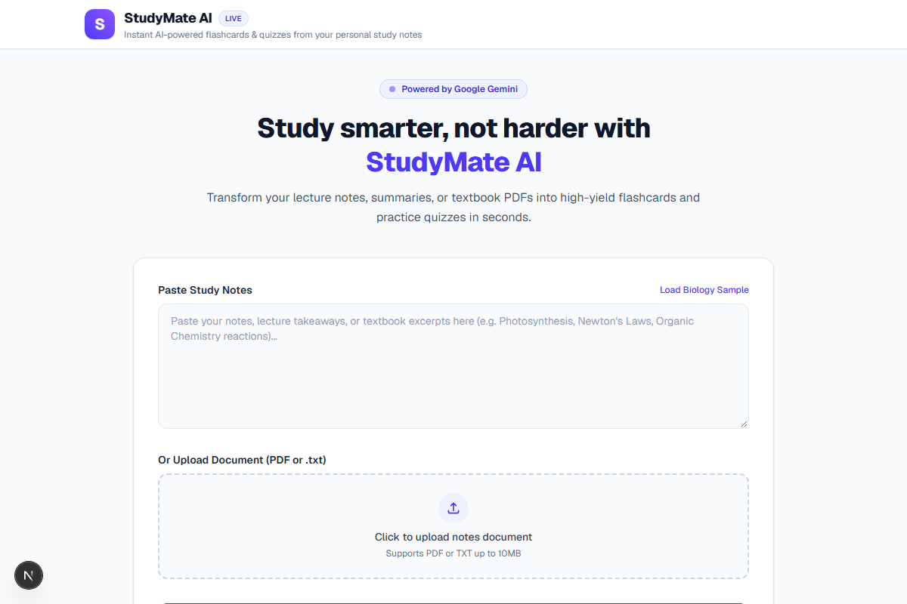
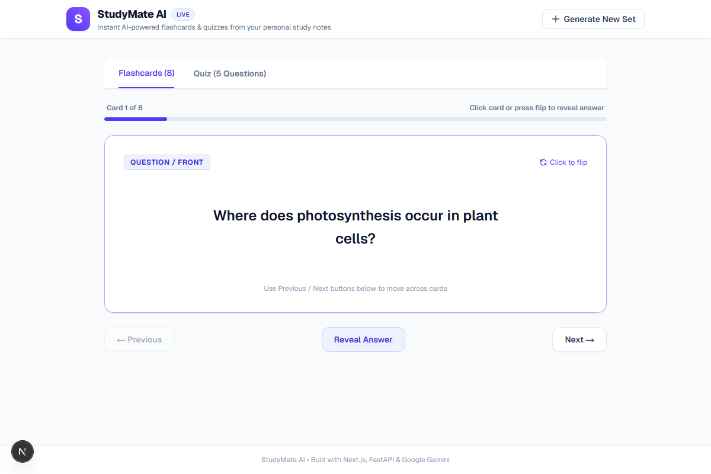
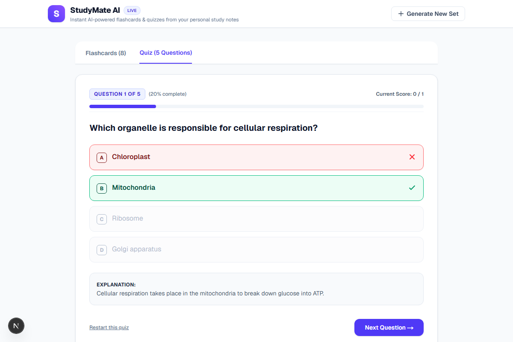
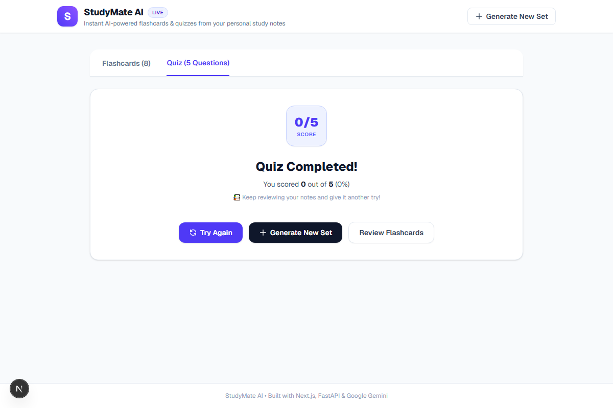

# StudyMate AI 🎓✨

> Transform your personal lecture notes and study materials into high-yield interactive flashcards and practice quizzes in seconds. Powered by Google Gemini AI, FastAPI, and Next.js.

[](https://nextjs.org/)
[](https://fastapi.tiangolo.com/)
[](https://tailwindcss.com/)
[](https://ai.google.dev/)

---

## 📖 Overview

Studying from dense textbooks or unstructured lecture slides is tedious and time-consuming. **StudyMate AI** bridges the gap between passive reading and active recall:

1. **Input Notes**: Paste notes directly or upload documents (`.pdf` or `.txt` up to 10MB).
2. **AI Generation Engine**: An optimized prompt sends your notes to Google Gemini, extracting key concepts and generating:
   - **8–10 High-Yield Flashcards**: Front (concept/term) and Back (explanation/definition).
   - **5 Multiple-Choice Quiz Questions**: 4 choices per question with instant scoring and detailed answer explanations.
3. **Interactive Study Session**:
   - Flip through flashcards with visual progress indicators.
   - Test your comprehension with a self-paced quiz featuring real-time feedback, progress tracking, and restart options.

---

## 📸 Screenshots

| 1. Home / Input View | 2. Interactive Flashcards |
| :---: | :---: |
|  |  |

| 3. Practice Quiz with Explanations | 4. Quiz Completion Screen |
| :---: | :---: |
|  |  |

---

## 🛠️ Tech Stack

### Frontend
- **Framework**: [Next.js (App Router)](https://nextjs.org/) (TypeScript)
- **Styling**: [Tailwind CSS](https://tailwindcss.com/)
- **Deployment**: [Vercel](https://vercel.com/)

### Backend
- **Framework**: [FastAPI](https://fastapi.tiangolo.com/) + [Uvicorn](https://www.uvicorn.org/)
- **AI / LLM**: [Google Generative AI SDK](https://ai.google.dev/) (`gemini-3.5-flash-lite` / REST transport)
- **Document Parsing**: [`pypdf`](https://pypdf.readthedocs.io/)
- **Deployment**: [Render](https://render.com/) (Web Service)

---

## 🚀 Getting Started Locally

### Prerequisites
- Node.js 18+ and npm
- Python 3.10+
- A Google Gemini API key ([Google AI Studio](https://aistudio.google.com/))

---

### 1. Backend Setup

```bash
# Navigate to backend directory
cd backend

# Create a virtual environment
python -m venv venv

# Activate virtual environment
# Windows:
.\venv\Scripts\activate
# macOS/Linux:
source venv/bin/activate

# Install dependencies
pip install -r requirements.txt

# Configure environment variables
# Create a .env file with your Gemini API key:
echo "GEMINI_API_KEY=your_gemini_api_key_here" > .env

# Start the FastAPI server
uvicorn app:app --reload --port 8000
```

The backend API will be running at `http://127.0.0.1:8000`.  
Explore interactive Swagger documentation at `http://127.0.0.1:8000/docs`.

---

### 2. Frontend Setup

```bash
# In a new terminal, navigate to frontend directory
cd frontend

# Install dependencies
npm install

# (Optional) Create .env.local if running backend on a custom port
# NEXT_PUBLIC_API_URL=http://127.0.0.1:8000

# Start Next.js development server
npm run dev
```

Open [http://localhost:3000](http://localhost:3000) in your browser.

---

## 🌐 Live Deployment Guide

### Deploying the Backend to Render (Free Tier)

1. Fork or push this repository to GitHub.
2. Sign in to [Render](https://render.com/) and click **New +** > **Web Service**.
3. Select your repository `studymate-ai`.
4. Configure the service settings:
   - **Name**: `studymate-ai-backend`
   - **Root Directory**: `backend`
   - **Runtime**: `Python 3`
   - **Build Command**: `pip install -r requirements.txt`
   - **Start Command**: `uvicorn app:app --host 0.0.0.0 --port $PORT`
5. Under **Environment Variables**, add:
   - `GEMINI_API_KEY`: `<Your-Google-Gemini-API-Key>`
   - `PYTHON_VERSION`: `3.12.0`
6. Click **Deploy Web Service**.
7. Once deployed, copy your backend URL: e.g. `https://studymate-ai-backend.onrender.com`.

---

### Deploying the Frontend to Vercel (Free Tier)

1. Sign in to [Vercel](https://vercel.com/) and click **Add New...** > **Project**.
2. Import your `studymate-ai` repository.
3. Configure the project:
   - **Root Directory**: Click *Edit* and select `frontend`.
   - **Framework Preset**: `Next.js` (auto-detected).
4. Under **Environment Variables**, add:
   - **Name**: `NEXT_PUBLIC_API_URL`
   - **Value**: `https://<your-render-backend>.onrender.com` (your live Render backend URL)
5. Click **Deploy**.
6. Vercel will build and assign a live production URL (e.g., `https://studymate-ai.vercel.app`).

---

## 📡 API Reference

### `GET /health`
Checks backend service health.
- **Response**: `{"status": "ok"}`

### `POST /generate`
Generates flashcards and quiz questions from text or document files.
- **Request Format**: `multipart/form-data` OR `application/json`
  - `text` *(string, optional)*: Raw notes text.
  - `file` *(binary, optional)*: Uploaded `.pdf` or `.txt` file (max 10MB).
- **Response**:
```json
{
  "status": "success",
  "notes_length": 520,
  "flashcards": [
    {
      "front": "What organelle carries out photosynthesis in plants?",
      "back": "Chloroplasts."
    }
  ],
  "quiz": [
    {
      "question": "What is the primary byproduct released during the light reactions of photosynthesis?",
      "options": ["Oxygen (O2)", "Carbon dioxide (CO2)", "Glucose", "Methane"],
      "correct_answer_index": 0,
      "explanation": "Photolysis of water during light reactions splits H2O, liberating O2."
    }
  ]
}
```

---

## 📄 License
MIT License. Built for students and lifelong learners.
